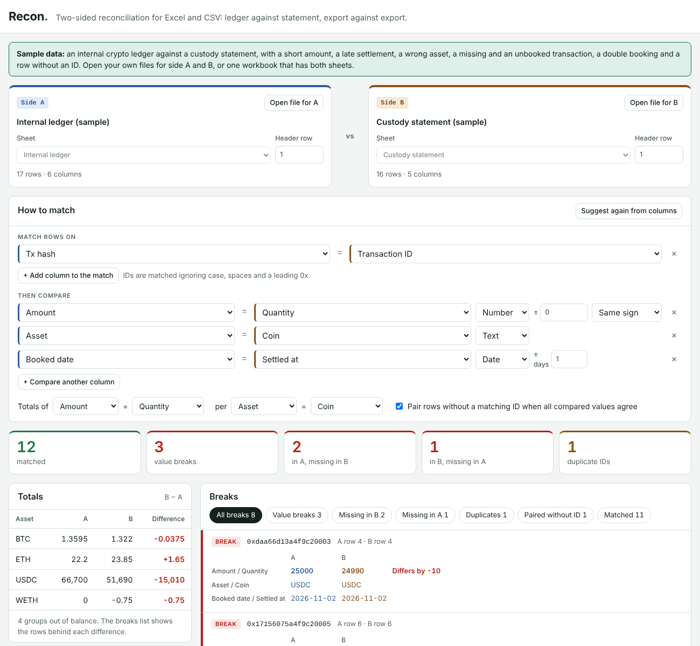

# Recon: two-sided reconciliation for Excel and CSV

**[Try it live](https://darkknight914914.github.io/recon/)**: opens with sample data, or load your own two files. Files are read in your browser and never uploaded.

Operations and finance teams spend hours putting two exports side by side: the internal ledger against the bank or custody statement, the payout file against what actually settled, one system's export against another's. Recon does that matching and explains every difference.

## What it does

1. **Load side A and side B.** Two files, or one workbook with both sheets. Opens .xlsx, .xlsm, .xlsb, .xls, .ods, .csv and .tsv, including German formats (`1.250,00`, `01.10.2026`, semicolon CSVs) and reports with title rows above the header.
2. **Suggests how to match.** Recon looks at column names *and* values to find:
   - the ID to match on (e.g. `Tx hash` = `Transaction ID`, matched ignoring case, spaces and a leading `0x`)
   - the amount, date and asset/currency columns to compare
   - the sign convention (a bank showing a payment as −1,200 where the ledger books +1,200)
   - the tolerance (exact for crypto amounts, ±0.005 for cents, ±1 day for settlement dates)
3. **Explains every break.**
   - **Value breaks:** same ID, different amount, asset or date, with the difference
   - **Missing in B / missing in A:** booked but not settled, or settled but never booked
   - **Duplicates:** the same ID twice on one side (a double booking)
   - **Paired without ID:** rows without a reference, matched because all compared values agree
4. **Totals per group** (e.g. per asset or currency): A, B and the difference, so you see which balance is off before reading row by row.
5. **Downloads a recon workbook** (.xlsx) with a summary, totals, every break side by side, the matched pairs and both sheets with the break cells colored, or just the breaks as CSV.

Everything is editable: add match columns, change tolerances, switch the sign convention. The setup is remembered for files with the same columns.

## Run it

- **Online:** the live link above (GitHub Pages).
- **Offline:** download `index.html` and open it in a browser. The Excel reader loads from a CDN the first time; CSV files work fully offline.

## Project layout

| Path | What |
|---|---|
| `src/recon.js` | Matching engine: key matching, tolerances, sign conventions, fallback pairing, duplicates, totals, mapping suggestions. Pure JavaScript, no DOM. |
| `src/export.js` | Builds the recon workbook and the breaks CSV |
| `src/app.js`, `src/template.html` | The page |
| `src/sample.js` | Sample ledger and custody statement with planted breaks |
| `vendor/` | Spreadsheet reading (CSV, number and date parsing) and a dependency-free .xlsx writer, copied in so the repo has no build dependencies |
| `tests/recon.test.js` | 22 tests, run with `node tests/recon.test.js` |
| `build.py` | Builds `index.html` (one self-contained page) from the sources |

## Status

Prototype, tested on sample crypto ledger/custody data, bank-vs-ledger exports and 20,000-row files (matched in well under a second). Built with Claude as a coding partner.

## Ideas for next versions

- Many-to-one matching (one statement line settling several ledger bookings, e.g. batched withdrawals or fees netted out)
- Fee handling: compare `amount` against `amount − fee`
- Ageing of open items (how long has a break been open?)
- Saved recon templates per counterparty
